# NSTP Portal Activity Diagram

This activity diagram summarizes the main end-to-end flow of the NSTP Portal and QR Code Attendance System, including public registration, authentication, role-based activities, QR attendance, learning management, reporting, and administration.

```mermaid
flowchart TB
    start((Start)) --> portal[Open NSTP Portal]
    portal --> account{Has an account?}

    account -- No --> publicForm[Open a public registration QR link or form]
    publicForm --> registrant{Registrant type?}

    registrant -- Student --> studentForm[Complete student registration form]
    studentForm --> validateStudent{Registration data valid?}
    validateStudent -- No --> correctStudent[Correct missing or invalid information]
    correctStudent --> studentForm
    validateStudent -- Yes --> saveStudent[Save registration and create or link student account]
    saveStudent --> generateQr[Create student masterlist record and unique QR code]
    generateQr --> sendStudentCredentials[Send account credentials when email is available]
    sendStudentCredentials --> login

    registrant -- Facilitator --> facilitatorForm[Complete facilitator registration form]
    facilitatorForm --> validateFacilitator{Registration data valid?}
    validateFacilitator -- No --> correctFacilitator[Correct missing or invalid information]
    correctFacilitator --> facilitatorForm
    validateFacilitator -- Yes --> createFacilitator[Create facilitator account]
    createFacilitator --> sendFacilitatorCredentials[Send account credentials]
    sendFacilitatorCredentials --> login

    account -- Yes --> login[Enter username or email and password]
    login --> authenticate{Credentials valid?}
    authenticate -- No --> loginError[Show error or start password reset]
    loginError --> login
    authenticate -- Yes --> createSession[Create session and record login activity]
    createSession --> role{Account role?}

    subgraph Student[Student activities]
        studentDashboard[Open student dashboard]
        studentChoice{Choose activity}
        viewQr[View or download personal QR code]
        viewAttendance[View attendance status and history]
        useLearning[Open learning materials]
        takeQuiz[Take available quiz and submit answers]
        viewComponent[View NSTP component information]
        updateProfile[View or update profile]

        studentDashboard --> studentChoice
        studentChoice --> viewQr
        studentChoice --> viewAttendance
        studentChoice --> useLearning
        useLearning --> takeQuiz
        studentChoice --> viewComponent
        studentChoice --> updateProfile
    end

    subgraph Staff[Facilitator activities]
        facilitatorDashboard[Open staff dashboard]
        facilitatorChoice{Choose activity}
        openScanner[Open attendance scanner and select Time In or Time Out]
        scanQr[Scan student QR code]
        validateQr{Student found and within assigned scope?}
        retryScan[Show validation message and rescan]
        duplicateCheck{Allowed for the selected scan mode?}
        attendanceMessage[Show duplicate or sequence message]
        saveAttendance[Save Time In or Time Out and attendance status]
        manageStudents[Manage assigned students and masterlist]
        manageLearning[Publish learning materials and manage quizzes]
        manageGrades[Compute, import, or export grades]
        staffReports[View graphs, downloads, announcements, and archives]

        facilitatorDashboard --> facilitatorChoice
        facilitatorChoice --> openScanner
        openScanner --> scanQr
        scanQr --> validateQr
        validateQr -- No --> retryScan
        retryScan --> scanQr
        validateQr -- Yes --> duplicateCheck
        duplicateCheck -- No --> attendanceMessage
        attendanceMessage --> scanQr
        duplicateCheck -- Yes --> saveAttendance
        saveAttendance --> scanQr
        facilitatorChoice --> manageStudents
        facilitatorChoice --> manageLearning
        facilitatorChoice --> manageGrades
        facilitatorChoice --> staffReports
    end

    subgraph Coordinator[Coordinator activities]
        coordinatorDashboard[Open coordinator dashboard]
        coordinatorChoice{Choose activity}
        manageRegistrations[Manage public registration forms and accounts]
        manageAssignments[Assign students, facilitators, components, and sections]
        configureAttendance[Configure attendance cutoffs and scan restrictions]
        coordinatorAttendance[Scan or manually record attendance within program scope]
        coordinatorAcademic[Manage learning content, quizzes, grades, and announcements]
        coordinatorReports[View graphs and export or archive records]
        reconcileSections[Reconcile CWTS or LTS sections when authorized]

        coordinatorDashboard --> coordinatorChoice
        coordinatorChoice --> manageRegistrations
        coordinatorChoice --> manageAssignments
        coordinatorChoice --> configureAttendance
        coordinatorChoice --> coordinatorAttendance
        coordinatorChoice --> coordinatorAcademic
        coordinatorChoice --> coordinatorReports
        coordinatorChoice --> reconcileSections
    end

    subgraph SuperAdmin[Super administrator activities]
        adminDashboard[Open administration dashboard]
        adminChoice{Choose activity}
        administerUsers[Manage facilitators, coordinators, and student accounts]
        administerRegistration[Manage public registrations and QR forms]
        administerAssignments[Manage student assignments and attendance settings]
        administerContent[Manage learning content, quizzes, grades, announcements, and landing content]
        administerData[Review edit requests, logs, archives, and reports]
        maintainSystem[Back up, clean up, and maintain the database]
        adminReconcile[Reconcile NSTP sections]

        adminDashboard --> adminChoice
        adminChoice --> administerUsers
        adminChoice --> administerRegistration
        adminChoice --> administerAssignments
        adminChoice --> administerContent
        adminChoice --> administerData
        adminChoice --> maintainSystem
        adminChoice --> adminReconcile
    end

    role -- Student --> studentDashboard
    role -- Facilitator --> facilitatorDashboard
    role -- Coordinator --> coordinatorDashboard
    role -- Super Admin --> adminDashboard

    viewQr --> studentChoice
    viewAttendance --> studentChoice
    takeQuiz --> studentChoice
    viewComponent --> studentChoice
    updateProfile --> studentChoice

    manageStudents --> facilitatorChoice
    manageLearning --> facilitatorChoice
    manageGrades --> facilitatorChoice
    staffReports --> facilitatorChoice

    manageRegistrations --> coordinatorChoice
    manageAssignments --> coordinatorChoice
    configureAttendance --> coordinatorChoice
    coordinatorAttendance --> coordinatorChoice
    coordinatorAcademic --> coordinatorChoice
    coordinatorReports --> coordinatorChoice
    reconcileSections --> coordinatorChoice

    administerUsers --> adminChoice
    administerRegistration --> adminChoice
    administerAssignments --> adminChoice
    administerContent --> adminChoice
    administerData --> adminChoice
    maintainSystem --> adminChoice
    adminReconcile --> adminChoice

    studentChoice -- Logout --> logout[End session]
    facilitatorChoice -- Logout --> logout
    coordinatorChoice -- Logout --> logout
    adminChoice -- Logout --> logout
    logout --> finish((End))
```

## Scope notes

- Attendance is recorded by authorized staff through QR scanning or manual entry; the system checks the staff member's assigned scope before saving a record.
- A Time Out requires an existing Time In for the same day, while a duplicate Time In or completed Time Out is rejected.
- Students can view their QR code, attendance history, learning materials, quizzes, component information, and profile.
- Coordinator and super administrator options remain subject to the role and NSTP program permissions enforced by the application.
